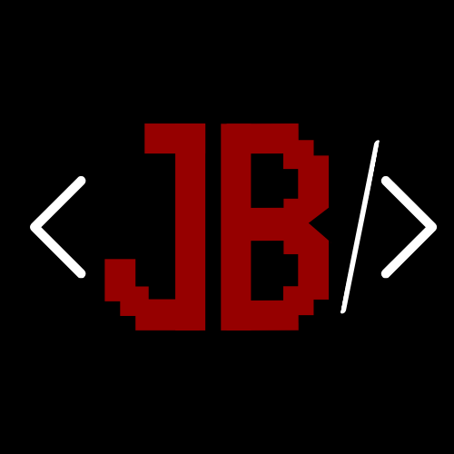

# Salut, moi c'est Justine 👋

  <picture>
    <source media="(prefers-color-scheme: dark)" srcset="https://readme-typing-svg.demolab.com?font=Raleway&weight=600&center=true&vCenter=true&width=500&color=CA8080&lines=En+alternance+sur+un+ERP+en+production;Du+serveur+%C3%A0+l%27interface;PHP%2C+JavaScript%2C+React">
    
  </picture>

Développeuse web, back et front, en alternance. Je fais évoluer des applications en production
autant que j'en crée de nouvelles. Je me forme à [La Manu](https://lamanu.fr/), campus de
Lacroix-Saint-Ouen.

  
  
  
  
  
  
  
  
  

## 💻 Ce que je fais

- 🏢 **En alternance chez [Litesoft](https://www.litesoft.fr/)** : un ERP en production depuis 2021,
  utilisé par environ 350 personnes, que je fais évoluer au quotidien. Une architecture MVC en **PHP** et une base
  **PostgreSQL** côté serveur, une interface **JavaScript** migrée de **Bootstrap** vers **Tailwind CSS**, un pipeline
  **GitLab CI** pour le déploiement. Du contrôleur
  à l'interface : moteur de filtres, module de gestion des stocks, audits de sécurité et de
  performance.
- 🎵 **YABT** : blind test musical multijoueur en temps réel, conçu et développé à quatre, d'une
  envie de mêler le code et la musique. Une interface **React**, un serveur **Node.js** qui
  synchronise les parties en **Socket.io** autour d'extraits de l'**API Deezer**, une base **MySQL**,
  le tout conteneurisé avec **Docker**.
- 🍔 **Panada Food** : [site vitrine d'un restaurant](https://panadafood.ovh), réalisé en binôme
  pendant un stage de BTS SIO, du recueil des besoins sur place à la mise en ligne.

## 🎮 Le reste du temps

- 🎵 Musique, sans laquelle YABT n'existerait pas
- 🕹️ Jeux vidéo et univers geek
- 🖨️ Impression 3D, sur une **Bambu Lab P1S**

## 📫 Me contacter

- ✉️ **blin.justine.sio@gmail.com**
- 🔗 [LinkedIn](https://www.linkedin.com/in/justine-blin-a88600292)

---

  

